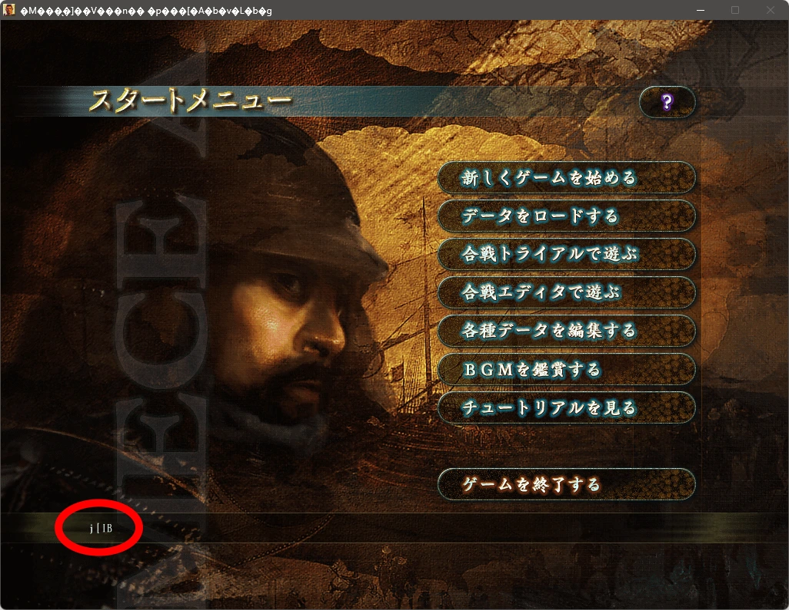
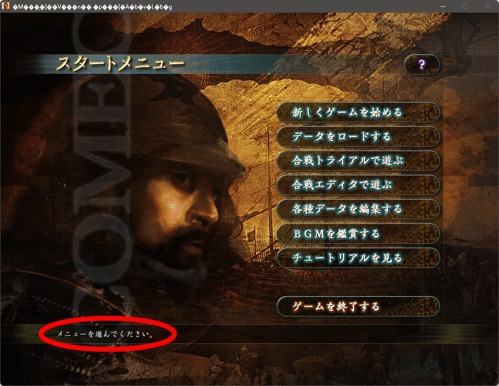

# Tenka Sousei Locale Fix

**Fix garbled Japanese text in *Nobunaga's Ambition: Tenka Sousei* (天下創世) and launch directly through Steam, as Gabe intended.**

For Windows and the Steam game that uses `Nobunaga11WPK.exe`. This unofficial, drop-in fix leaves your Windows system locale and the game's executable on disk unchanged.

## TL;DR

[**Download d3d8.dll**](https://github.com/AEnigmatrices/tenka-sousei-locale-fix/releases/latest/download/d3d8.dll), put it beside `Nobunaga11WPK.exe` in the game folder, then launch through Steam. Find the folder with **Steam → right-click the game → Manage → Browse local files**.

## Download

[**Download the fix for Windows**](https://github.com/AEnigmatrices/tenka-sousei-locale-fix/releases/latest/download/tenka-sousei-locale-fix-windows-x86.zip)

The ZIP contains `d3d8.dll` and installation instructions. Only the DLL needs to go in your game folder.

[All releases](https://github.com/AEnigmatrices/tenka-sousei-locale-fix/releases) · [Changelog](CHANGELOG.md)

## Before and after

The red circles highlight Japanese help text in the game's start menu. Click either screenshot to view it at full size.

| Without the fix | With the fix |
| :---: | :---: |
| [](images/before.webp) | [](images/after.webp) |

## Installation

Close the game before installing. If the game folder already contains `d3d8.dll` from another mod, keep that file: this fix cannot be installed alongside another Direct3D 8 proxy.

1. Download and extract **tenka-sousei-locale-fix-windows-x86.zip** using the link above.
2. In Steam, right-click the game and select **Manage → Browse local files**.
3. Copy the extracted **`d3d8.dll`** into the folder containing **`Nobunaga11WPK.exe`**.
4. Launch the game normally through Steam, as Gabe intended.

```text
Game installation folder/
├── Nobunaga11WPK.exe
├── d3d8.dll             ← Copy into this folder
└── ...
```

Japanese menu help text should appear as shown in the “With the fix” screenshot.

## Uninstallation

Close the game, then remove the `d3d8.dll` you installed from the game folder.

## Known limitations

- This fix restores Japanese text; it does not translate the game into English.
- Some Windows-managed strings, including the window title, may remain garbled.
- Another graphics mod that also uses `d3d8.dll` cannot be installed alongside this fix.

## Troubleshooting

**Text is still garbled:** Make sure the ZIP has been extracted and `d3d8.dll` is directly beside `Nobunaga11WPK.exe`, then restart the game through Steam.

**The game will not launch:** Remove this fix's `d3d8.dll` and try launching again. If removing it restores startup, leave the fix uninstalled. The source documentation describes the game-build and runtime conditions the DLL recognizes.

**Using a different game version:** [Locale Emulator](https://github.com/xupefei/Locale-Emulator) remains an alternative way to launch older Japanese games in a Japanese locale environment.

## How it works

The game expects Japanese **CP932** text encoding. Its older text-processing runtime can initialize with a different code page, causing Japanese bytes to be interpreted incorrectly.

The game loads this fix as a **Direct3D 8 proxy**. It forwards graphics calls to the Windows Direct3D 8 library and uses the recognized game's existing multibyte initialization routine to select CP932.

### First, what is a DLL?

A **DLL** (short for **Dynamic-Link Library**) is a Windows file, usually ending in `.dll`, that contains code and sometimes other resources for programs to use. Rather than building every feature into a program's `.exe` file, developers can put reusable functionality in a DLL and have Windows load it when needed.

In this case, `Nobunaga11WPK.exe` is the game, while `d3d8.dll` provides **Direct3D 8 graphics functions** that the game calls. Windows normally supplies this library, so there does not have to be a `d3d8.dll` in the game folder.

A DLL is **executable code, not just a data file**. You generally don't launch one directly like an `.exe`; instead, a program loads it and calls its functions. This is why the origin of a DLL matters—and why the security warning below is worth reading.

### Why does placing one DLL beside the game work?

The game asks Windows to load a library named `d3d8.dll` for Direct3D 8 graphics. For this game's ordinary DLL lookup, Windows can find a file with that name **in the game's folder before the system copy**. The original installation does not need to contain its own `d3d8.dll`: without this fix, Windows normally loads its own.

This project provides a **DLL proxy** with the expected Direct3D 8 exports. The game loads the local proxy, which loads the genuine Windows `d3d8.dll` from the system directory and forwards graphics calls to it. At specific, verified game call sites, the proxy also uses the game's existing routine to initialize Japanese CP932 text handling.

```text
Nobunaga11WPK.exe
    | requests d3d8.dll
    v
Game folder/d3d8.dll      <-- this fix's proxy
    | forwards graphics calls
    v
Windows system d3d8.dll   <-- the genuine Direct3D library
```

This is Windows' DLL-loading mechanism, **not a Steam feature or a universal way to override any DLL**. Search behavior depends on the application, how it loads a library, and Windows protections such as Known DLLs and explicit library paths. See [Microsoft's DLL search-order documentation](https://learn.microsoft.com/en-us/windows/win32/dlls/dynamic-link-library-search-order).

### A security note: do not install arbitrary DLLs

**The same DLL-loading behavior can be abused.** Attackers use techniques commonly called *DLL search-order hijacking* or *DLL sideloading* to have an application load malicious code. A DLL loaded into a game runs inside the game's process, with the privileges that process has. A malicious DLL could do much more than forward graphics calls. **DLL proxying is not inherently malicious, but a DLL being called a "fix" does not make it safe.**

Before installing a DLL-based mod or compatibility fix:

- Download it from a source you trust. For this project, use the [official GitHub releases](https://github.com/AEnigmatrices/tenka-sousei-locale-fix/releases), not an unknown mirror.
- Review the [source code](source/README.md), build process, and release information if you want to assess what it does. The provided SHA-256 checksums can help detect an altered download, **but a matching checksum is not proof that the code is safe**.
- Install this DLL **only beside `Nobunaga11WPK.exe`** as instructed. Do not copy it into Windows system folders, disable security protections, or run the game as administrator just to use this fix.
- If you do not trust a DLL or cannot establish where it came from, do not load it. Removing a malicious DLL afterward does not necessarily undo what it may already have done.

For background, see [Microsoft's guidance on DLL-loading security](https://learn.microsoft.com/en-us/windows/win32/dlls/dynamic-link-library-security).

[Source code](source/README.md) · [Build instructions](source/BUILDING.md) · [Release process](RELEASING.md)

## About this project

This is an **unofficial fan-made compatibility fix**, unaffiliated with Koei Tecmo, Steam, or Microsoft. The repository contains no proprietary game executable or game resources.

The fix's code is available under the [MIT License](LICENSE). Game content shown in the screenshots belongs to its respective owners.
